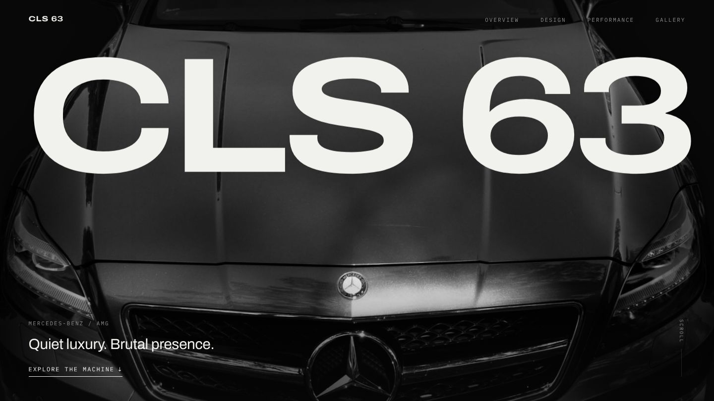
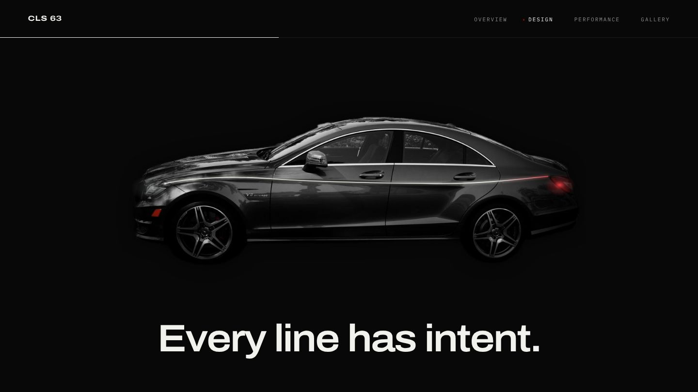

<div align="center">

# CLS 63

**Quiet luxury. Brutal presence.**

A dark, cinematic scroll-through of the Mercedes-AMG CLS 63.<br>
Less like a dealership website, more like a gallery after hours.

### [→ View the live site](https://uncdrew8.github.io/cls63-showcase/)



</div>

---

## What you'll see

Scroll from top to bottom and the page plays out like a short film:

| | Scene | What happens |
|---|---|---|
| 01 | **Hero** | Giant `CLS 63` type rises over the bonnet. The photo and type move apart as you scroll. |
| 02 | **Presence, without permission.** | The headline slides up line by line, and the paragraph sharpens word by word. |
| 03 | **The light trace** ✦ | The page pauses on the car's side profile. A thin silver line travels from the headlight along the shoulder, warms to red, and lights the taillight. |
| 04 | **Composure meets force.** | 550 hp, 590 lb-ft and 4.3 s count up beside a close-up of the V8. |
| 05 | **The pause** | One wide photograph and almost no words. |
| 06 | **Studies in shadow** | An asymmetric gallery. Click any image for a full-screen view. |
| 07 | **Leave an impression.** | The sign-off. |

<div align="center">



*The signature moment. The line is drawn to follow this exact photograph.*

</div>

## The car

Every photo shows **the same car**: one 2013 CLS63 AMG with the AMG Performance Package.
Each photo was cut out, set on pure black, and graded to black paint.
Only the red brake calipers and taillights keep their colour.

| | |
|---|---|
| **Engine** | 5.5 L V8 biturbo, 5,461 cc |
| **Output** | 550 hp |
| **Torque** | 590 lb-ft |
| **0–60 mph** | 4.3 s |
| **Top speed** | 186 mph (electronically limited) |
| **Gearbox** | AMG SPEEDSHIFT MCT 7-speed, rear-wheel drive |

*US specification, from Mercedes-Benz USA's published figures. Sources are in [`NOTES.md`](NOTES.md).*

## Built with

- **React + TypeScript + Vite**: the app itself
- **[Lenis](https://github.com/darkroomengineering/lenis)**: smooth scrolling, driven by GSAP's clock so everything moves in sync
- **[GSAP](https://gsap.com) + ScrollTrigger**: every scroll-driven animation, including the pinned light trace
- **[React Bits](https://reactbits.dev)**: one component, `ScrollReveal`, used only on the intro paragraph
- **Archivo** (variable width) and **IBM Plex Mono**: bundled locally, with no external font requests

There's no WebGL, no video background and no custom cursor.

## Run it yourself

```bash
npm install
npm run dev        # → http://localhost:5173
npm run build      # production build in dist/
```

Every push to `main` deploys to GitHub Pages automatically through `.github/workflows/deploy.yml`.

## Make it yours

Nearly everything you'd want to change is in **one file**: [`src/data/site.ts`](src/data/site.ts). It holds the copy, captions, alt text, specs, image slots and photo credits.

- **Swap photos:** drop files into `src/assets/cls63/` using the slot names (`hero.jpg`, `profile.jpg`, …). A missing photo shows a labelled placeholder, never a broken image.
- **Re-make the black-on-black look:** run the *Prepare photos* workflow in the Actions tab, or run `python scripts/process_photos.py <originals> src/assets/cls63`.
- **Change the side photo?** Re-trace the light path in `design.trace` so it follows the new car. [`DESIGN.md`](DESIGN.md#the-light-trace) explains how.

## Accessible by design

- With *Reduce motion* turned on, nothing pins and nothing moves sideways. The light trace simply appears complete.
- All content is in the page before JavaScript runs, so animations decorate the page rather than gate it.
- Every control works by keyboard, with visible focus rings. The gallery viewer traps focus and closes with Esc.

## More docs

| File | What's inside |
|---|---|
| [`DESIGN.md`](DESIGN.md) | Design specs: palette, type, layout, motion rules, section by section |
| [`NOTES.md`](NOTES.md) | Decisions, sources, photo credits and known limits |
| [`CLAUDE.md`](CLAUDE.md) | Working notes for AI coding assistants contributing to this repo |
| [`docs/Project log.md`](docs/Project%20log.md) | How the project was built, where it stands, and what's open |

> **Obsidian user?** This repo doubles as a vault. Clone it, open the folder in Obsidian, and start at `docs/Home.md`.

## Credits & license

- **Photos:** Michael Sheehan, via [Wikimedia Commons](https://commons.wikimedia.org/), licensed [CC BY 2.0](https://creativecommons.org/licenses/by/2.0/). Backgrounds were removed, and the photos were recoloured and cropped for this site. Full list in [`NOTES.md`](NOTES.md#photo-credits).
- **`ScrollReveal`:** from React Bits by David Haz, licensed MIT + Commons Clause.
- **Code:** [MIT](LICENSE).

> This is an independent fan project. It is not an official Mercedes-Benz or Mercedes-AMG website, and it is not affiliated with or endorsed by Mercedes-Benz Group AG. Mercedes-Benz, AMG and CLS are trademarks of their respective owner.
